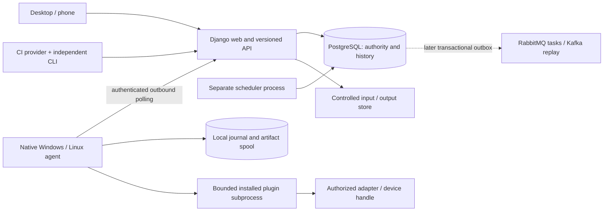

# Architecture

## M2B.6 result/evidence boundary

Assignment-bound ordered events, fixed-name bounded SQL bytea outputs and an immutable ExecutionResult extend the existing allocator. Upload metadata/bytes commit atomically; result commit verifies the complete sealed inventory and immutable context before ACK eligibility. Native journal accepts only the authenticated matching backend ACK and retains all files. Current-authorized JSON and attachment routes share job scope. Basic job detail shows separate outcome/cleanup/evidence. All leases remain held; complete portal/readiness/release/cancel and M3 recovery remain later gates. Older sections describe their historical milestones. See [M2B_6.md](M2B_6.md) and [STATUS.md](STATUS.md).

## Implemented in M2B.5

Opt-in separate PostgreSQL allocator commits immutable Attempt plus global/agent/device/shared leases before native polling. Native agent downloads scoped bounded inputs and delegates to its durable journal/contained runner. The SQL control receipt records only a completion digest; local reports remain unacknowledged, leases held. Default is disabled; one global worker/assignment per agent. No physical readiness or backend outcome. Earlier milestone sections describe their historical scope. See [M2B_5.md](M2B_5.md) and [STATUS.md](STATUS.md).

Scope follows the [unified roadmap](PLAN.md) and [requirements checklist](REQUIREMENTS.md). M2A adds durable queued submission; M2B.1 adds native agent identity and idle contact. M2B.2 adds explicit local synthetic file analysis; the historical M2B.2 gate had no platform workload dispatch or hardware execution. Detailed contracts/setup are in [M2A.md](M2A.md).

## Implemented in M2B.4

`agent/journal.py` adds a root-scoped SQLite WAL/FULL ledger, canonical immutable delivery identity, local overlap exclusion and short transactions. Acceptance/launch intent precede process creation; observer hooks persist worker birth identity before the plugin gate. Duplicate delivery never invokes the runner. A flushed checksummed spool seal precedes SQL completion, allowing safe completion-commit recovery; missing/unverifiable completion stays uncertain with scope held. Local ACK is explicitly a demonstration, not a backend upload receipt, and deletes no evidence/dedup record. No SQL scheduling authority or dispatch is added. See [M2B_4.md](M2B_4.md); main merge awaits explicit approval.

## Implemented in M2B.3

`agent/runner.py` stages bounded local files, starts a fixed child behind containment/launch gates, drains capped output and validates/collects reports. Windows uses suspended launch plus Job Objects with hard job memory/CPU/process controls; Linux uses a session/group, worker resource limits and monitored group/disk budgets. Their scopes differ and are recorded in run.json. Cooperative cancellation precedes bounded escalation and observed stop confirmation. Cleanup is restricted to exact acquired file identities; uncertainty defers cleanup and sets a local quarantine-required flag. No SQL allocation/quarantine or journal is implemented. The local CLI is separate from network heartbeats; it cannot execute queued jobs. See [M2B_3.md](M2B_3.md). User approved the M2B.3 merge into main; M2B.4 remains planned.

## Implemented in M2B.2

Installed `workloads/` provides a pure bounded CAN payload comparator, fixed registry and explicit local CLI, with shared `contracts/plugins.py` schemas/capabilities. It produces deterministic schema-versioned JSON/human evidence; raw data is recoverable from hex, offsets refer to normalized payload and mismatch totals remain complete with bounded details. Actual built-wheel SHA-256 and matching installed modules bind a new immutable version. Trusted local publication creates a new version, never mutates historical metadata versions; approval/grants remain separate. HTTP workers still only queue; no runner, dispatch or result ingestion exists. See [M2B_2.md](M2B_2.md).

## Implemented in M2B.1

The separately installable `agent/` process shares strict versioned DTOs in `contracts/agents_v1.py`, with no Django dependency. Administrator-approved single-use enrollment exchanges a short-lived hashed secret for a separate scoped runtime credential. Agent, AgentDevice, AgentEnrollment, AgentCredential and bounded AgentHeartbeat records persist in PostgreSQL. Each idle heartbeat rechecks identity, credential and enabled same-project device bindings. Manager mutations and enrollment create audit events. Heartbeat replay does not refresh contact time.

Identity binding is not an execution reservation. Contact timestamps do not establish liveness, hardware readiness or stopped workloads. The only live agent endpoints are enrollment and idle heartbeat; assignment is null and execution is unavailable. Future assignment/result DTO definitions do not enable dispatch. Local credential JSON is not an execution journal. Native Windows contact/rotation/revocation and PostgreSQL enrollment contention have actual checks; other platforms, services, hardware and scheduling remain unverified. See [M2B_1.md](M2B_1.md).

## Implemented in M2A

Drafts publish immutable TestVersion snapshots and separate administrator TestApproval records. TestGrant now distinguishes catalog visibility (version null) from explicit version submission permission. Inputs use generated immutable Artifact identities, SQL ownership/size/checksum and private bounded blobs. ServicePrincipal/ServiceToken scopes are separate from browser users, with hashed expiring/rotatable/revocable credentials and active owner membership/grants checked on every request. Account/session/invitation revocation is audited; session epochs prevent revival after reactivation.

Typed `contracts/v1.py` feeds shared business services in `lab/submissions.py`; HTML forms and JSON APIs use the same rules. Browser API mutations retain CSRF; invalid bearer credentials never fall back to a session. A short transaction locks requester user then project, validates every batch item and current approval/version/device/input authority, computes a canonical request hash, and creates Batch/Job/Run with a requester-scoped unique key. Same-key/same-body returns the existing IDs; changed body conflicts. Every new job remains queued, with immutable configuration/context snapshot and no attempt/outcome. There is no hardware reservation/dispatch.

PostgreSQL triggers protect published-version/input metadata against UPDATE/DELETE. Actual PostgreSQL 18.1 integration proved concurrent identical submissions create one job and an actual server restart preserves queued data. This is submission concurrency evidence, not M3 device scheduling proof. See M2A.md for SQLite trigger differences, trusted OS/database boundary and private orphan-file limits. Compose web/PostgreSQL, initial GitLab CI and an installable contract package are provided; only local packaging/static/tests are verified, not Docker/Linux/hosted CI.

## Implemented in M0/M1

A modular Django app in `web/` renders HTML on the server. Browser forms use Django CSRF protection; sessions are stored in SQL. At this historical gate no agent process existed; M2B.1 now adds the identity-only process above. There is no SPA or task broker. Phone browsers are control clients in the design; they never acquire physical hardware themselves.

Request path: browser → security/session/CSRF middleware → authenticated view → `access.scope` checks current project membership → `access.records` filters records by current explicit grants → template. List filtering and direct detail lookup use the same querysets. Platform superusers see all projects; an Administrator membership applies only to its project. A grant grants catalog visibility now, not permission to execute an unapproved workload. No role preview exists, so there is no silent authorization switching.

Implemented SQL models: custom Django User, Project, Membership, Device (unregistered inventory), TestDefinition (non-executable catalog), DeviceGrant, TestGrant, Invitation (token hash only), AuditEvent, LoginBucket. UUIDs identify projects/devices/tests, but authorization does not rely on UUID secrecy. Membership changes, grants, invitation creation/acceptance and bootstrap use transactions with audit writes; login/logout/recovery also create security events. Application users have no audit-edit endpoint. The trusted local OS/database owner remains able to alter the database.

The user interface is plain templates/CSS. Four roles have distinct context and controls; navigation hides manager-only pages. Resource lists become stacked cards on narrow screens. Full page server navigation means there are no asynchronous fetch/loading spinners to get stuck; empty and error pages are explicit. There are no real or mock results. Discovery-not-active and execution-unavailable labels explain zero counts. Local time is shown in America/Los_Angeles; database timestamps are timezone-aware UTC.

## Planned execution architecture (M2B+)

Extend the existing immutable versions, approvals, agents, jobs, runs, batches, artifacts and service principals with Attempt, Resource, Reservation/Lease, Measurement, ExecutionEvent and Schedule/Occurrence incrementally. PDF execution_id maps to Attempt ID: delivery retries reuse it, actual attempts/reruns get new IDs with lineage. Preserve immutable plugin digest/schema, test version, known Git commit, device/hardware/firmware/agent versions, input checksums/roles, parameters, configuration, actual/simulated source/environment, requester and every attempt. Unknown measurements stay unknown; historical firmware cannot come from current inventory. Lifecycle/outcome/evaluation and timeout mappings are canonical in PLAN; pending cancellation is distinct from confirmed termination and cleanup/readiness/evidence status.

`agent/` is now a separate native identity/contact package; a future scheduler will run separately within the modular backend codebase. `workloads/` contains installed allowlisted plugins/adapters, starting with synthetic CAN payload file comparison, readiness and simulations. `contracts/` introduces typed v1 API/report schemas in M2A; `cli/` and `examples/` arrive with clients/fixtures. Add package metadata and compatible locking without reorganizing existing code merely to match the PDF. No FastAPI/SQLAlchemy/Alembic rewrite. HTTP workers never execute workloads.

M2A now persists approved versions, input artifacts and idempotent queued submissions on PostgreSQL. M2B will add basic SQL-exclusive assignments before delivery, native agent journal/spool and bounded subprocess execution. Agent-local SQLite will record accepted attempt/epoch/process before launch and retain evidence until backend acknowledgement; it is not the platform authority. Outbound heartbeats will run independently; restart/redelivery must reconcile rather than launch again. Competing schedulers, lost contact and safe reconciliation will be proven in M3. Coordinated multi-resource work remains rejected until M3C.

PostgreSQL will be authoritative for scheduling, users/grants and resource ownership. Before dispatch, recheck active user, membership/action, version approval, explicit test grant and device grants. Validate all items before accepting a batch. Reserve shared resources transactionally with unique fencing tokens and expiring leases. A stale attempt cannot finalize/release someone else's lease. Lease expiry does not prove a physical process stopped; require confirmed termination and readiness before reuse, otherwise quarantine the resource as unavailable. Preserve original failures and all retries, with bounded retries only for configured transient infrastructure errors.

Agents will authenticate every outbound registration/heartbeat/poll/event/result/upload using unique scoped, revocable/rotatable credentials. CI already has separate project/resource-scoped service token foundations. Hardware hosts need no inbound public port. At-least-once delivery needs canonical request hashes/idempotency, local journal dedup and checksum-stable result/upload replay; no universal exactly-once physical-action claim. Transactional outbox begins at the first SQL/broker boundary in M6A, then extends to Kafka in M7; SQL writes and broker sends are not one transaction. Celery/RabbitMQ transport is distinct from Kafka replay. Hardware ownership stays with host agents outside Kubernetes. Controlled input storage exists now; execution outputs/events/retention/reconciliation remain planned.

M4 proves platform CI separately from product/hardware CI using a provider-independent CLI and versioned JSON/human/JUnit reports. CI failure exit status survives evidence collection, and client polling timeout cannot release hardware. M5 adds real adapters/Linux service/secure phone operation only with actual equipment and separately approved deployment. M6A/M6B/M7 retain the original distributed/telemetry/native/events/warehouse portfolio after the core. PostgreSQL continues to decide access/ownership even when extra stores/brokers are present.

The diagram is the planned full execution architecture. Django web/API, PostgreSQL queued state and controlled input store now exist; scheduler/agent/runner/adapter/brokers remain planned. Drawing a component does not establish integration.
